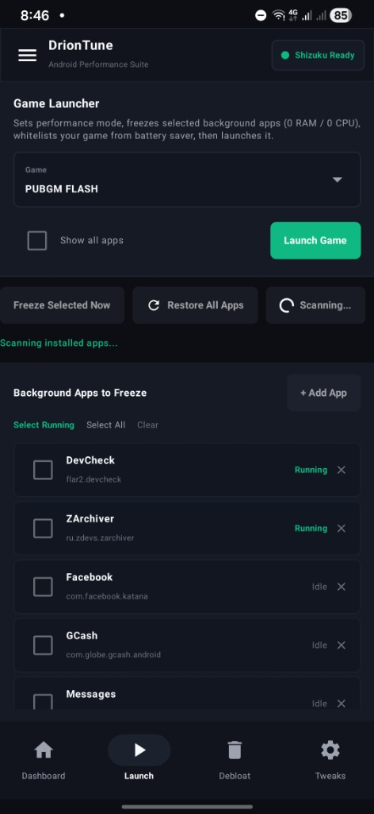

  
  <h1>DrionTune</h1>
  
Android performance tuning and game launcher without root.

  

    
    
    
    
  

---

##  Download

Download [DrionTune v1.0.0 (APK)](https://github.com/gwenz2/DrionTune/releases/latest/download/app-release.apk). You also need the free [Shizuku](https://shizuku.rikka.app/) app from Google Play for the one-time setup.

---

## Screenshots

<table>
  <tr>
    <td align="center"><strong>Live Dashboard & 1-Click Fix Lag</strong></td>
    <td align="center"><strong>Game Launcher & App Freezer</strong></td>
  </tr>
  <tr>
    <td></td>
    <td></td>
  </tr>
</table>

---

##  Why DrionTune Is Different

Most "Phone Booster" apps on the Play Store play a rocket animation and close apps that restart a few seconds later, wasting more battery and RAM.

DrionTune uses Android's own system commands through Shizuku. When you freeze background apps before a game, they stay paused at zero RAM and zero CPU until you tap Restore All Apps. DrionTune also stops polling telemetry the moment you switch into your game, so it does not sit in the background eating CPU.

---

##  How It Works

The Dashboard reads live CPU load, physical RAM, ZRAM swap pressure, battery temperature, and active processes so you can see what is slowing your phone down. Tapping **1-Click Fix Lag** clears cache bloat, trims memory, and stops heavy background processes.

Before you open a game, the **Launch** tab pauses noisy apps like social media or shopping apps and keeps Android's battery saver from throttling your game. When you finish playing, tap **Restore All Apps** to bring everything back.

---

## Why Use It If Your Phone Is Lagging

DrionTune helps if your games stutter because background apps keep waking up, if your phone has 3 GB to 6 GB of RAM and hits heavy swap compression, or if your device heats up from too many apps running at once. It gives you system-level control without rooting your phone or unlocking the bootloader.

---

##  Downsides & Use at Your Own Risk

- **Requires Shizuku:** Android blocks normal apps from freezing other apps. You have to start Shizuku through Wireless Debugging once, and start it again after a phone reboot.
- **No notifications from frozen apps:** Any app you freeze stays completely paused until you tap Restore All Apps.
- **Hardware limits still apply:** Freezing background apps improves stability and thermals, though it cannot make an older chip run heavy games beyond its hardware limit.
- **Use at your own risk:** DrionTune has been tested on 3 phones. Because it uses Shizuku system privileges to freeze apps and change device tuning, improper use (such as disabling critical system apps) can break apps or cause missed notifications. The developer is not responsible for issues caused by misuse.
- **Free vs Pro:** Dashboard, 1-Click Fix Lag, and Game Launcher are free with ads, plus a 30-minute System Tweaks trial if you watch a short rewarded ad. Pro ($3 one-time on [Gumroad](https://gwennydev.gumroad.com/l/driontune-pro)) unlocks Debloater, permanent System Tweaks, and removes all ads.

---

##  Setup & Updates

1. Install **Shizuku** from Google Play and start it via Wireless Debugging in Developer Options.
2. Install **DrionTune** (`app-release.apk`) and tap Allow when Shizuku asks for permission.
3. Use **Check for Updates** in the app menu whenever a new version is posted here to download and install updates in place.
