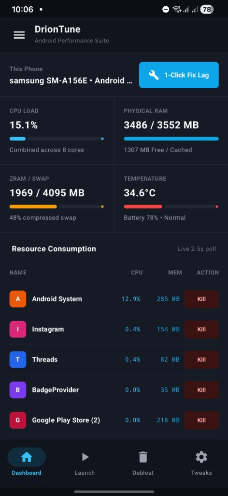
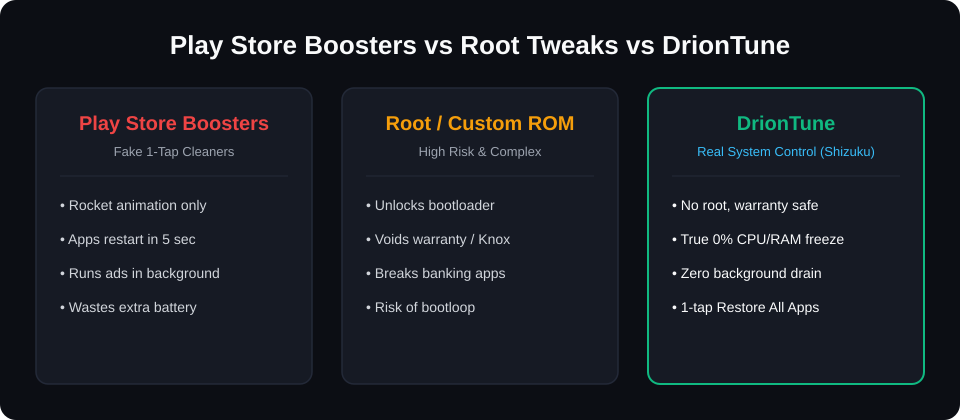

  
  <h1>DrionTune</h1>
  
<strong>Stop background apps from stealing RAM and overheating your phone while gaming. No root needed.</strong>

  
Built for 3 GB to 6 GB Android phones that stutter mid-match when Facebook, shopping apps, and system services wake up in the background.

  

    
    
    
    
  

  

    <a href="https://github.com/gwenz2/DrionTune/releases/latest/download/app-release.apk"><strong>Download DrionTune v1.0.0 (APK)</strong></a>
    &nbsp;|&nbsp;
    Requires free <a href="https://shizuku.rikka.app/">Shizuku</a> app
  

---

## Screenshots

<table>
  <tr>
    <td align="center"><strong>Live CPU, RAM, ZRAM & 1-Click Fix</strong></td>
    <td align="center"><strong>Real App Freezer & Game Launcher</strong></td>
  </tr>
  <tr>
    <td></td>
    <td></td>
  </tr>
</table>

---

##  Why Other "Lag Fixers" Fail

  

Play Store booster apps play a rocket animation and close apps that Android restarts 5 seconds later, burning more battery and RAM.

DrionTune uses Android's own system commands through Shizuku to actually **suspend** selected background apps (`0%` CPU, `0 MB` RAM) until you tap **Restore All Apps**. When you switch into your game, DrionTune stops polling telemetry so it does not eat CPU either.

---

##  What It Does

1. **1-Click Fix Lag:** Clears cache bloat, trims memory, and stops heavy background processes while showing live CPU, RAM, ZRAM swap, and battery temperature.
2. **Game Launcher:** Freezes noisy apps (social media, shopping, banking) before launching your game and keeps battery saver from throttling it.
3. **Restore All Apps:** One tap brings every paused app and its notifications right back after gaming.

---

##  Downsides & Use at Your Own Risk

- **Needs Shizuku:** Android blocks normal apps from freezing other apps, so you must start Shizuku via Wireless Debugging once (and again after a reboot).
- **Frozen apps stay silent:** While an app is frozen for gaming, it will not send notifications until you tap Restore All Apps.
- **Hardware limits:** Freeing RAM and cooling thermals reduces stutter, though it cannot turn an old processor into a flagship chip.
- **Use at your own risk:** Tested on 3 phones. Because DrionTune uses Shizuku system privileges, disabling critical system apps or applying unsafe tweaks can break apps or cause missed notifications. The developer is not responsible for issues from misuse.
- **Free vs Pro:** Dashboard, 1-Click Fix Lag, and Game Launcher are free with ads, plus a 30-minute System Tweaks trial via rewarded ad. Pro ($3 one-time on [Gumroad](https://gwennydev.gumroad.com/l/driontune-pro)) unlocks Debloater, permanent System Tweaks, and removes all ads.

---

##  Setup & In-App Updates

1. Install **Shizuku** from Google Play and start it via Wireless Debugging in Developer Options.
2. Install **DrionTune** (`app-release.apk`) and tap Allow when Shizuku asks for permission.
3. Open the menu and tap **Check for Updates** whenever a new version drops to download and install in place.
